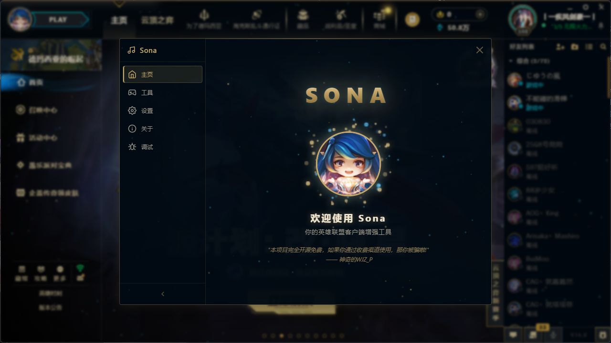
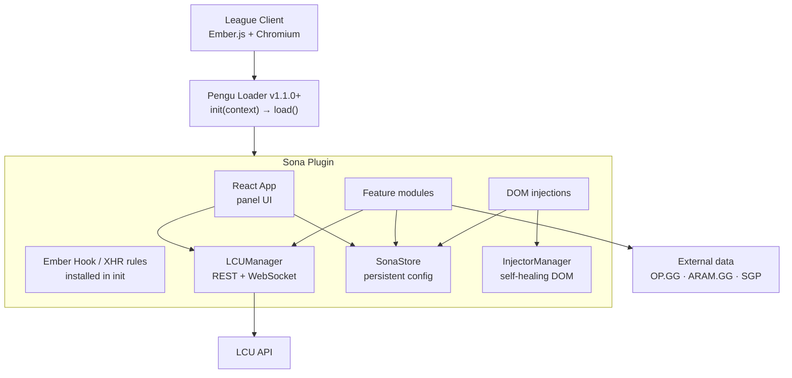

## A League of Legends Client Enhancement Plugin for Pengu Loader

<div align="center">

  <a href="https://github.com/WJZ-P/sona/graphs/contributors">
    
  </a>
  &nbsp;
  <a href="https://github.com/WJZ-P/sona/network/members">
    
  </a>
  &nbsp;
  <a href="https://github.com/WJZ-P/sona/stargazers">
    
  </a>
  &nbsp;
  <a href="https://github.com/WJZ-P/sona/issues">
    
  </a>
  &nbsp;
  <a href="https://github.com/WJZ-P/sona/blob/main/LICENSE">
    
  </a>

</div>

<br>

<p align="center">
  <a href="https://github.com/WJZ-P/sona/">
    
  </a>
</p>

<h1 align="center">Sona</h1>

<p align="center">
  <a href="README.md">简体中文</a>
  ·
  English
  <br>
  <a href="#installation">Quick Start</a>
  ·
  <a href="https://github.com/WJZ-P/sona/issues">Report Bug</a>
  ·
  <a href="https://github.com/WJZ-P/sona/issues">Request Feature</a>
</p>

<p align="center">
  
</p>

<p align="center"><em>Open Sona from the icon beside the Play button, or press F1 at any time.</em></p>

## Table of Contents

- [Introduction](#introduction)
- [Features](#features)
- [Screenshots](#screenshots)
- [Installation](#installation)
- [Usage](#usage)
- [Notes](#notes)
- [Architecture](#architecture)
- [Development](#development)
- [License](#license)
- [Acknowledgements](#acknowledgements)
- [Important Notice](#important-notice)

## Introduction

Sona is a free and open-source League of Legends client enhancement plugin built on top of [Pengu Loader](https://pengu.lol/). It runs inside the League Client Chromium environment and communicates with the client through LCU REST APIs and WebSocket events.

Sona focuses on practical quality-of-life improvements: champion select tools, match history lookup, OP.GG build recommendations, lobby and social enhancements, client beautification, custom avatars, replay tools, and a convenient in-client settings panel.

## Features

58 features in total, grouped by category. Click a category to expand it.

<details>
<summary><b>🎮 Match and Champion Select</b> (14)</summary>

|  | Feature | Description |
|:---:|---|---|
| ⚡ | **Auto Accept** | Automatically accepts queue pop, with an optional random delay and the ability to decline after accepting. |
| 🎯 | **Auto Pick / Auto Ban Queue** | Configure multiple candidate champions; unavailable ones are skipped by priority. Auto pick can either lock in or only hover, and is skipped when you are autofilled in ranked. |
| 🔄 | **ARAM Bench No Cooldown** | Removes bench swap cooldown in ARAM. |
| 🔵 | **Side Indicator** | Reports whether your team is blue side or red side in champion-select chat. |
| 📊 | **Deadweight Detector** | Uses matches from the current mode to calculate win rate, KDA, and a `3.0–16.0` strength score, ranks teammates into tiers, and posts the result to chat (visible to yourself only, or to the whole team). |
| 🌟 | **Champion Select Assist** | Adds 5 win-rate particle tiers to teammate portraits, shows win rate and KDA, and opens match history on click. |
| 🔒 | **Privacy / Streamer Mode Support** | Keeps teammate analysis working when names are hidden, restores real names beside client aliases, and tracks player swaps. |
| 🏷️ | **Champion Tier Badges** | Shows OP.GG tier badges on the champion grid, bench, and your team's portraits (ARAM Mayhem uses ARAM.GG data). |
| 📈 | **Game Analysis Popup** | Displays both teams' win rate, KDA, rank, and premade groups after entering game; a "Game Analysis" button in the in-game panel reopens it any time. |
| 🚪 | **Champion Select Quit Button** | Adds a quick exit button to non-custom champion select so you can return to the lobby. |
| 🔁 | **Auto Return to Lobby** | Returns to lobby after a game while keeping your premade, with "auto queue" or "return only" modes and retry logic. |
| 🛡️ | **Balance Buff Tooltip** | Shows mode-specific balance modifiers on hover in ARAM (including ARAM Mayhem), URF, One for All, Nexus Blitz, Arena, and Ultimate Spellbook. Data is synced automatically every week. |
| 👍 | **Auto Honor** | Randomly honors teammates after the game. |
| 🧩 | **Lobby Enhancement** | Click lobby member avatars for match history and show recent performance above banners. |

</details>

<details>
<summary><b>🧠 Smart Builds</b> (6)</summary>

|  | Feature | Description |
|:---:|---|---|
| 🧰 | **OP.GG Recommendation Panel** | Opens from the button under skin selection after lock-in. Shows core items, runes, summoner spells, build trends, and matchups; Arena and ARAM Mayhem also show augments. |
| 🎮 | **In-game Build View** | A "Build Recommendations" button in the in-game panel lets you check this game's build from the client. |
| 🧭 | **Position-aware Recommendations** | Uses your assigned role in ranked, the champion's most common role elsewhere, and offers a Top/Jungle/Mid/ADC/Support selector. |
| 🧠 | **Auto Runes & Summoner Spells** | Remembers and restores manually saved runes and spells per champion and mode; the final loadout is learned before your first game. Off by default. |
| 📦 | **Auto Item Sets** | Writes Sona-managed item sets by mode and role, sorted by win rate, while preserving user-created item sets. Off by default (not recommended yet — may scramble your item sets). |
| 🛟 | **Multi-mode Fallbacks** | Supports ranked, normal, ARAM, Arena, and special modes, and fills missing recommendation sections from available data. |

</details>

<details>
<summary><b>🔍 Match History</b> (4)</summary>

|  | Feature | Description |
|:---:|---|---|
| 🔍 | **Player Lookup** | Search any player by Riot ID. Loads 20 games first, with "Load more" for further pages. Cross-region lookup is not supported. |
| 🏷️ | **Mode Filter** | Filter match history by queue using SGP query tags. |
| 📋 | **Match Details** | View champions, KDA, items, runes, spells, CS, gold, and damage; click a game for the full 10-player breakdown. |
| 📎 | **Game ID Copy** | Copy Game ID for replay tools. |

</details>

<details>
<summary><b>👥 Social</b> (10)</summary>

|  | Feature | Description |
|:---:|---|---|
| ✏️ | **Unlock Status Message** | Removes the client-side lock from status editing. |
| 📱 | **Enhanced Availability** | Supports extra statuses such as offline and mobile, with startup restore. |
| 🖼️ | **Custom Profile Background** | Use any skin as your profile background (visible to friends), with search and lazy loading. |
| 🎏 | **Custom Banner** | Locally display any challenge banner (visible only to you). |
| 👥 | **Premade Friend Marker** | Marks friends in the same premade with matching colors. |
| ⏱️ | **Enhanced Friend Status** | Shows in-game friends' mode and elapsed game time in the social sidebar. |
| 🎭 | **Rank Disguise** | Disguise the rank shown in friend cards (visible to friends), with one-click restore. |
| 🚫 | **Remove Crest** | Remove profile crest decoration. |
| 🏅 | **Remove Challenge Badges** | Clear all three challenge badge slots under your profile icon in one click. |
| 🧹 | **Reset Avatar** | Restore the default client avatar. |

</details>

<details>
<summary><b>🎨 Beautify</b> (9)</summary>

|  | Feature | Description |
|:---:|---|---|
| 🎨 | **Beautify Page** | A dedicated page for client visual customization. |
| 🖼️ | **Custom Home Wallpaper** | Use images or videos from `assets` as the home background, with drag-and-zoom cropping, blur, and tint. |
| 🪄 | **Wallpaper Mode and Scene Glass** | Hides the home activity center, clears the sidebar background, and adjusts blur for mode-select and lobby scenes. |
| 🎲 | **Random Wallpaper** | Randomly applies one wallpaper on each client start while avoiding immediate repeats when possible. |
| 🧊 | **Friends Sidebar Glass** | Independently adjusts blur and tint for the social sidebar and the wallpaper-mode sidebar. |
| 🧭 | **Top Navigation Styling** | Adjusts navbar blur and optionally hides icon separators and the bottom border. |
| 🧑‍🎤 | **Custom Avatars** | Manage multiple local avatars and sync them between friends who both use Sona, with an offline cache fallback. |
| 🌈 | **Flowing Summoner Names** | Configures a smooth looping gradient and syncs it across the friends list, lobby, and champion select. |
| 📦 | **Asset Manager** | Opens the `assets` folder in one click; add files by name (extensions optional, subfolders supported) and drag them onto the wallpaper or avatar area. |

</details>

<details>
<summary><b>🧰 Tools</b> (7)</summary>

|  | Feature | Description |
|:---:|---|---|
| 🎬 | **Replay Tool** | Download and watch replays by Game ID. |
| 💾 | **Settings Backup** | Back up and restore client settings (general + hotkeys) with multiple named saves per account. |
| 🎁 | **Battle Pass Rewards** | Review pending choice rewards and claim only the items you select, or claim everything in one click. |
| 🪟 | **Window Effects** | Blur-behind, acrylic, unified, mica (Win11), and transparent window effects. |
| ✨ | **Global Particles** | Adds star-like particles to the client background. |
| 🔔 | **Update Checker** | Checks releases on startup and lets you read the notes, open the release, or skip a version. |
| 🔧 | **Debug Panel** | LCU, chat, replay, builds, status-payload inspection, and mock game-analysis tools for advanced users. |

</details>

<details>
<summary><b>🖥️ Interface</b> (8)</summary>

|  | Feature | Description |
|:---:|---|---|
| 🏠 | **Sona Entry** | Quick entry beside the Play button; can be hidden in Settings (the hotkey still works). |
| ⌨️ | **Hotkey** | Press F1 (configurable F1–F5) to open or close the panel. |
| 🚀 | **Quick Lobby** | Skips mode selection from Play and opens a configured queue lobby directly. |
| 🗂️ | **Game Mode Filter** | Hides unwanted queue entries from the PvP mode-selection page. |
| 🧹 | **Client UI Cleanup** | Can hide the TFT entry, Classic mode entry, right-navbar labels, and esports broadcast popup. |
| 🎨 | **Restore Chromas Tab** | Restores the hidden Chromas sub-tab on supported collection pages. |
| 🌐 | **Internationalization** | Supports Simplified Chinese, English, and automatic language detection. |
| 🔄 | **Self-healing DOM** | Re-applies every injection automatically after the client's Ember.js re-renders. |

</details>

## Screenshots

<details>
<summary><b>Champion Select Assist</b></summary>

<p align="center">
  
</p>

</details>

<details>
<summary><b>Champion Tier Badges</b></summary>

<p align="center">
  
</p>

</details>

<details>
<summary><b>Build Recommendations</b></summary>

<p align="center">
  
</p>

</details>

<details>
<summary><b>Augment Recommendations</b></summary>

<p align="center">
  
</p>

</details>

<details>
<summary><b>Lobby Enhancement</b></summary>

<p align="center">
  
</p>

</details>

<details>
<summary><b>Enhanced Friend Status</b></summary>

<p align="center">
  
</p>

</details>

<details>
<summary><b>Custom Profile Background</b></summary>

<p align="center">
  
</p>

</details>

<details>
<summary><b>Custom Banner</b></summary>

<p align="center">
  
</p>

</details>

## Installation

### Requirements

- [Pengu Loader](https://pengu.lol/) v1.1.0 or later (latest recommended)
- League of Legends client

### Steps

1. Install Pengu Loader from the [Pengu Loader releases](https://github.com/PenguLoader/PenguLoader), start it, and make sure it shows `ready`.
2. Download the latest `sona-vX.Y.Z.zip` from this repository's [Releases](https://github.com/WJZ-P/sona/releases) page. Do not use the source-code archive as a plugin package.
3. In Pengu Loader, open the Plugins tab and click "Open plugins folder".
4. Extract the `sona` folder into the plugins folder. It should contain `index.js`, `index.css`, and an `assets` folder.
5. Click "Refresh" in Pengu Loader, make sure `sona` is checked, and restart the League client.

> 💡 **Upgrading**: extract the new package over the existing folder. **Do not delete the whole `sona` folder first** — custom wallpapers and avatars you placed in `assets` would be lost. Settings are stored in Pengu Loader's DataStore and survive upgrades. Sona also checks for new releases on startup.

## Usage

1. Start the League client.
2. Click the Sona icon beside the Play button, or press `F1` (configurable F1–F5 in Settings).
3. Switch pages from the sidebar:
   - **Tools** — match, build, match-history, social, and interface features
   - **Beautify** — wallpapers, glass effects, navbar styling, custom avatars, flowing names, and asset management
   - **Rewards** — claim pending battle pass rewards
   - **Settings** — language, hotkey, hiding the entry icon, global particles, and developer mode
4. Settings are saved automatically and restored on next launch.

## Notes

1. Sona requires Pengu Loader and cannot run standalone.
2. Sona communicates with the League Client through LCU APIs and DOM integration. It does not modify game files or inject into the game process.
3. Custom avatars and flowing names use hidden status payloads; both friends need Sona enabled to see each other's synchronized effects.
4. Build recommendations use third-party data sources such as OP.GG and ARAM.GG.
5. Match history prefers the SGP API and falls back to the client's native endpoint when SGP is unavailable; some regions or client states may still fail to return data.
6. Settings backups are stored in Sona's DataStore and scoped per account (PUUID).
7. Rank disguise only affects friend-card display and does not alter real ranked data.

## Architecture

<details>
<summary>Click to expand</summary>



Core modules:

- `LCUManager`: wraps LCU REST APIs and WebSocket events; match history prefers SGP and falls back to the native client endpoint.
- `InjectorManager`: a single MutationObserver throttled by `requestAnimationFrame` keeps DOM injections alive through client re-renders.
- Ember Hook: hooks `getEmber()` through Pengu's RCP API during `init` to change client behavior at the component level.
- XHR rules: request rewrite rules installed during `init`, e.g. blocking client ad popups.
- `SonaStore`: typed configuration, DataStore persistence, and change listeners.
- Feature modules: independent lifecycle units driven by store toggles.
- Lightweight i18n: dictionary-based Chinese/English translations; `auto` follows the client's `html lang`.

</details>

## Development

```bash
npm install
npm run dev
npm run build
```

<details>
<summary>Project structure</summary>

```text
sona/
├── src/
│   ├── index.tsx                      # Plugin entry (init / load lifecycle)
│   ├── App.tsx                        # Main app (sidebar + page routing)
│   ├── i18n/                          # Lightweight i18n (zh / en / auto)
│   ├── data/
│   │   └── champion-balance.json      # Per-mode balance data (synced by CI)
│   ├── lib/
│   │   ├── lcu.ts                     # LCU REST + WebSocket wrapper, SGP match history
│   │   ├── store.ts                   # Config (DataStore persistence + listeners)
│   │   ├── features.ts                # Feature lifecycle registration
│   │   ├── features/                  # Feature modules (auto accept, pick/ban, builds, game analysis, ...)
│   │   │   └── beautify-client/       # Client beautification (wallpaper, glass, navbar, avatars, names)
│   │   ├── injections.ts              # DOM injection registry
│   │   ├── InjectorManager.ts         # Global MutationObserver (self-healing DOM)
│   │   ├── ember-hook.ts              # Ember component hook via RCP API
│   │   ├── xhr/                       # XHR request rewrite rules
│   │   ├── opgg-api.ts                # OP.GG builds / runes / tiers
│   │   ├── aramgg-api.ts              # ARAM.GG ARAM Mayhem data
│   │   ├── player-strength-score.ts   # Scoring for Deadweight Detector / game analysis
│   │   ├── champ-select-puuid.ts      # PUUID recovery in anonymous champ select
│   │   ├── image-hosting-service.ts   # Image hosting for custom avatars
│   │   ├── update-checker.ts          # Release update checker
│   │   ├── plugin-resolver.ts         # Plugin asset path resolution
│   │   ├── assets.ts                  # Game asset mapping (items / spells / champions / runes / queues / maps)
│   │   ├── modal.ts                   # Panel visibility + hotkey
│   │   ├── hooks.ts                   # React hooks
│   │   ├── logger.ts                  # Logger
│   │   └── utils.ts                   # Utilities
│   ├── types/
│   │   ├── lcu.ts                     # LCU API types
│   │   └── sgp.ts                     # SGP match history types
│   ├── components/
│   │   ├── pages/                     # Home / Tools / Beautify / Rewards / Update / Settings / About / Debug
│   │   └── ui/                        # Shared components and modals
│   └── styles/                        # Page and component styles
├── scripts/
│   └── update-champion-balance.ts     # Scrapes mode balance data from the Fandom LoL Wiki
├── .github/
│   └── workflows/
│       ├── release.yml                # Build and publish a Release on v* tags
│       └── update-balance.yml         # Weekly balance sync with automatic patch releases
├── assets/                            # Static assets (Sona icon)
├── markdown/                          # README images
├── CHANGELOG.md
├── pengu.yml                          # Pengu plugin metadata
├── pengu.d.ts                         # Pengu Loader API types
├── package.json
├── tsconfig.json
├── vite.config.ts
└── LICENSE                            # AGPL-3.0
```

</details>

## License

This project is licensed under AGPL-3.0. See [LICENSE](LICENSE) for details.

## Acknowledgements

Sona learned a lot from the League client plugin community. Special thanks to:

- [BakaFT / BetterTencentLCU](https://github.com/BakaFT/BetterTencentLCU)
- [imunproductive / upl](https://github.com/imunproductive/upl)
- [BakaFT / CustomHookLoader](https://github.com/BakaFT/CustomHookLoader)
- [nomi-san / balance-buff-viewer](https://github.com/nomi-san/balance-buff-viewer)
- [LeagueAkari / LeagueAkari](https://github.com/LeagueAkari/LeagueAkari)

## Important Notice

> This project does not accept sponsorship.
>
> This project does not accept Pull Requests.
>
> Feedback, ideas, and bug reports are welcome through [Issues](https://github.com/WJZ-P/sona/issues).

## If Sona helps you, please consider giving the project a star.

[](https://starchart.cc/WJZ-P/sona)
