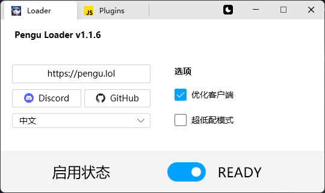
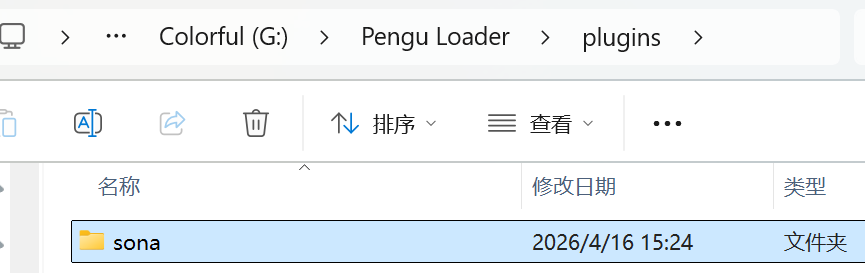
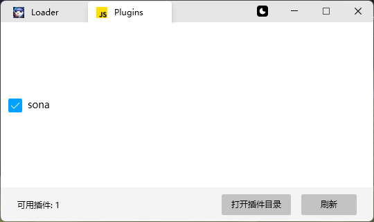
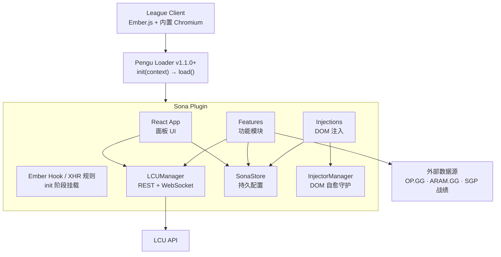
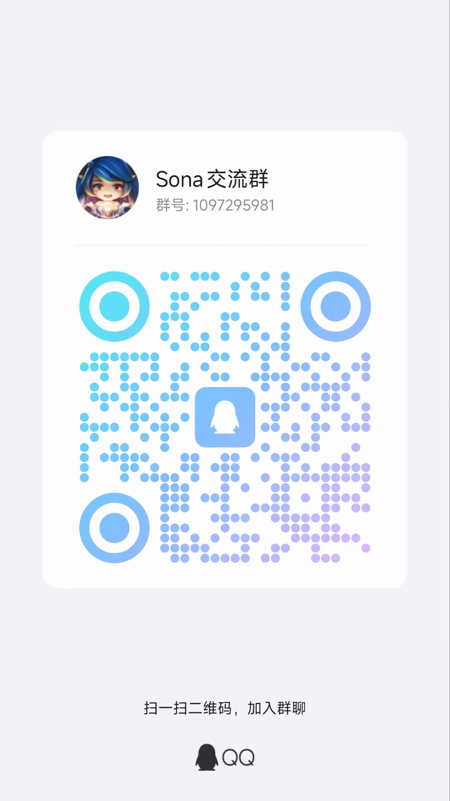

## 一款基于Pengu Loader的全服可用英雄联盟客户端增强插件
<!-- PROJECT SHIELDS -->

<div align="center">

  <a href="https://github.com/WJZ-P/sona/graphs/contributors">
    
  </a>
  &nbsp;
  <a href="https://github.com/WJZ-P/sona/network/members">
    
  </a>
  &nbsp;
  <a href="https://github.com/WJZ-P/sona/stargazers">
    
  </a>
  &nbsp;
  <a href="https://github.com/WJZ-P/sona/issues">
    
  </a>
  &nbsp;
  <a href="https://github.com/WJZ-P/sona/blob/main/LICENSE">
    
  </a>

</div>

<br>

<!-- PROJECT LOGO -->

<p align="center">
  <a href="https://github.com/WJZ-P/sona/">
    
  </a>
</p>

<h1 align="center">Sona</h1>

<p align="center">
  简体中文
  ·
  <a href="README.en-US.md">English</a>
  <br>
  <a href="#安装">快速开始</a>
  ·
  <a href="https://github.com/WJZ-P/sona/issues">报告 Bug</a>
  ·
  <a href="https://github.com/WJZ-P/sona/issues">提出新特性</a>
</p>

<!-- LYRICS -->


<p align="center">
  <a href="https://www.bilibili.com/video/BV1La4Fz1Een">
    
  </a>
</p>

<h2 align="center">

「当心弦交缠相牵 &nbsp; 花开遍荒芜岁月 &nbsp; 我们相伴在过去与明天」

</h2>

## 目录
- [简介](#简介)
- [功能特性](#功能特性)
- [效果展示](#效果展示)
- [安装](#安装)
- [使用](#使用)
- [注意事项](#注意事项)
- [技术架构](#技术架构)
- [项目结构](#项目结构)
- [交流群](#交流群)
- [To Do List](#to-do-list)
- [License](#license)
- [致谢](#致谢)
- [重要声明](#重要声明)

<br>

<h2 id="简介">简介</h2>

<p align="center">
  
</p>

<p align="center"><em>▲ Sona 插件面板 — 按 F1 随时呼出，集成战绩查询、秒抢英雄、队友分析等丰富功能</em></p>

<br>

<h2 id="功能特性">✨ 功能特性</h2>

共 58 项功能，按分类折叠，点击展开查看 👇

<details>
<summary><b>🎮 对局增强</b>（14 项）</summary>

|  | 功能 | 说明 |
|:----:|------|------|
| ⚡ | **自动接受对局** | 匹配到对局时自动接受，可配置随机延迟，并可在接受后继续点击拒绝 |
| 🎯 | **秒选 / 自动 Ban 英雄队列** | 支持配置多个候选英雄，按优先级自动跳过不可用英雄；秒选可选「秒选并锁定」或「仅预选」，排位被系统补位时自动跳过 |
| 🔄 | **大乱斗无CD换英雄** | 移除共享池英雄的切换冷却限制，随时换取心仪英雄 |
| 🔵 | **红蓝方提示** | 进入英雄选择时在队伍聊天中提示本局所在阵营 |
| 📊 | **牛马检测器** | 按当前模式查询队友近期战绩，计算胜率、KDA 与 `3.0～16.0` 综合评分，按队内排名给出「千里马 / 上等马 / 中等马 / 下等马 / 纯牛马」评级并发送到聊天框，可选仅自己可见或全队可见 |
| 🌟 | **英雄选择阶段增强** | 根据胜率为队友头像添加 5 档粒子特效，底部显示胜率和 KDA；点击队友头像可查看详细战绩 |
| 🔒 | **隐私 / 主播模式兼容** | 隐藏队友名称时仍可分析战绩；选人界面补全真实名称，并保留客户端匿名代号和锁标识，换楼后自动同步 |
| 🏷️ | **英雄 T 级角标** | 在英雄选择网格、备选席和己方头像上展示 OP.GG 英雄 T 级角标（海克斯大乱斗使用 ARAM.GG 数据） |
| 📈 | **全局战力分析弹窗** | 进入游戏后自动弹窗展示双方队伍胜率、KDA、段位、开黑分组；「游戏仍在进行中」面板内嵌「对局分析」按钮，可随时重新打开 |
| 🚪 | **选人阶段退出按钮** | 非自定义对局的英雄选择界面右下角提供快捷退出按钮，可直接返回组队界面 |
| 🔁 | **对局结束自动返回房间** | 对局结束后自动返回房间，保留开黑车队；支持「自动排队」和「仅返回房间」两种模式，内置重试机制 |
| 🛡️ | **平衡性调整 buff 提示** | 在大乱斗（含海克斯大乱斗）、无限火力、克隆、极限闪击、斗魂竞技场、终极魔咒书中，悬停英雄头像显示该模式的平衡性数值调整；数据每周自动同步 |
| 👍 | **对局结束自动点赞** | 对局结束后自动随机给队友点赞 |
| 🧩 | **组队界面增强** | 在组队界面点击成员头像区域查看战绩，并在旗帜上方展示该模式近期胜率、KDA 和综合评分 |

</details>

<details>
<summary><b>🧠 智能配装</b>（6 项）</summary>

|  | 功能 | 说明 |
|:---:|------|------|
| 🧰 | **OP.GG 配装推荐面板** | 锁定英雄后点击皮肤选择下方的按钮打开，展示当前英雄与模式的核心装备、符文、召唤师技能、出装趋势和优势 / 劣势对局；斗魂、海斗额外展示海克斯推荐 |
| 🎮 | **游戏中查看配装** | 进入游戏后，「游戏仍在进行中」面板内嵌「配装推荐」按钮，切回客户端即可查看本局配装 |
| 🧭 | **智能分路推荐** | 排位优先使用本局分配位置，普通模式自动选择英雄最常见分路，也可在面板中手动切换上野中下辅 |
| 🧠 | **自动配置符文 & 召唤师技能** | 按「英雄 + 模式」自动记忆并恢复玩家手动保存过的符文与召唤师技能；首次游玩会在进入游戏前记录最终配置（默认关闭） |
| 📦 | **自动配装** | 锁定英雄后按模式和分路写入 Sona 管理的客户端装备集，按胜率排序出门装、鞋子、核心装和后续装备，并保留玩家自建装备集（默认关闭，暂不推荐使用，可能导致配装错乱） |
| 🛟 | **多模式数据兜底** | 适配排位、普通、大乱斗、斗魂和特殊模式；推荐分段缺失时自动使用可用数据补全 |

</details>

<details>
<summary><b>🔍 战绩查询</b>（4 项）</summary>

|  | 功能 | 说明 |
|:---:|------|------|
| 🔍 | **任意玩家战绩查询** | 输入召唤师名#Tag 查询近期战绩，首屏加载 20 场，可点「加载更多」继续翻页；不支持跨联盟大区查询 |
| 🏷️ | **模式过滤** | 支持按游戏模式下拉筛选（排位/匹配/大乱斗/斗魂等），使用 SGP 接口按队列过滤 |
| 📋 | **详细战报** | 每场显示英雄、KDA、装备、符文、召唤师技能、补刀、金币、伤害，点击可展开整局十人详情 |
| 📎 | **Game ID 复制** | 一键复制 Game ID，配合回放功能使用 |

</details>

<details>
<summary><b>👥 社交</b>（10 项）</summary>

|  | 功能 | 说明 |
|:---:|------|------|
| ✏️ | **解锁自定义签名** | 移除客户端对签名编辑的禁用限制 |
| 📱 | **增强在线状态** | 支持手机在线、隐身等额外状态，并在客户端启动时恢复上次选择 |
| 🖼️ | **自定义生涯背景** | 可从所有皮肤中选择生涯背景（不限于已拥有，好友可见），支持搜索和分页懒加载 |
| 🎏 | **自定义挑战旗帜** | 在挑战身份页面选择任意旗帜作为本地展示（仅自己可见），支持段位旗帜与未拥有旗帜 |
| 👥 | **开黑好友标记** | 同一对局中的好友用相同颜色标记，一眼看出谁在开黑 |
| ⏱️ | **增强游戏中好友状态** | 右侧好友列表显示游戏中好友的模式和实时对局时长 |
| 🎭 | **段位伪装** | 伪装好友列表名片中显示的段位（好友可见），支持黑铁到最强王者任选，一键恢复真实段位 |
| 🚫 | **卸下头像边框** | 一键移除头像框装饰，恢复干净头像 |
| 🏅 | **卸下身份徽章** | 一键清空头像下方的三个挑战徽章展示位 |
| 🧹 | **卸下头像** | 一键恢复客户端默认召唤师头像 |

</details>

<details>
<summary><b>🎨 美化</b>（9 项）</summary>

|  | 功能 | 说明 |
|:---:|------|------|
| 🎨 | **美化页面** | 侧边栏「美化」分页，集中管理客户端视觉美化功能 |
| 🖼️ | **自定义主页壁纸** | 支持将 `assets` 中的图片 / 视频设为主页背景，可拖动、缩放调整取景，并调节模糊和底色 |
| 🪄 | **壁纸模式与场景毛玻璃** | 隐藏首页活动中心、清空右侧栏背景，并单独调节模式选择、组队大厅等场景的毛玻璃强度 |
| 🎲 | **随机壁纸** | 客户端启动时从主页壁纸列表随机应用一张，并尽量避免和上次重复 |
| 🧊 | **好友栏毛玻璃** | 独立调节右侧好友栏和壁纸模式侧栏的模糊与底色强度 |
| 🧭 | **顶部导航栏美化** | 支持调节导航栏模糊强度，并可隐藏图标分隔线与底部边框 |
| 🧑‍🎤 | **自定义头像** | 支持多头像列表与点击切换；双方安装 Sona 时可同步显示，并为离线好友保留本地缓存 |
| 🌈 | **流光召唤师名** | 自定义渐变起止色和角度，平滑循环流动，并同步到好友栏、组队大厅与英雄选择界面 |
| 📦 | **资源管理** | 一键打开 `assets` 目录；输入文件名即可录入，可省略 `.png` / `.mp4` 等后缀并支持子目录，从资源列表拖到壁纸或头像区即可使用 |

</details>

<details>
<summary><b>🧰 工具</b>（7 项）</summary>

|  | 功能 | 说明 |
|:---:|------|------|
| 🎬 | **回放观看** | 输入 Game ID 下载或直接观看对局回放 |
| 💾 | **设置备份/恢复** | 备份客户端设置（常规配置 + 热键），按账号保存多个命名存档 |
| 🎁 | **通行证奖励领取** | 展示所有待选择奖励，可按奖励规则勾选领取，也可「一键领取」全部 |
| 🪟 | **窗口特效** | 毛玻璃、亚克力、混合、云母（Win11）、透明等窗口视觉效果 |
| ✨ | **全局粒子美化** | 为客户端添加星光粒子背景效果 |
| 🔔 | **版本更新检查** | 启动时检查新版本，可查看发布说明、前往 Release 或暂时跳过该版本 |
| 🔧 | **开发者调试面板** | 完整的 LCU API 调试工具，含战绩、聊天、回放、配装、签名解析和对局分析模拟等 |

</details>

<details>
<summary><b>🖥️ 界面</b>（8 项）</summary>

|  | 功能 | 说明 |
|:---:|------|------|
| 🏠 | **Sona 入口** | 客户端 Play 按钮旁的快捷入口，可在设置中隐藏（隐藏后仍可用快捷键呼出面板） |
| ⌨️ | **快捷键** | 按 F1（可配置 F1~F5）随时呼出/关闭面板 |
| 🚀 | **快速大厅模式** | 点击 Play 时跳过模式选择，直接进入预设队列的组队大厅 |
| 🗂️ | **游戏模式过滤** | 在玩家对战页面按需隐藏不常玩的队列入口 |
| 🧹 | **客户端界面精简** | 可隐藏首页云顶之弈、经典模式入口、顶部右侧导航文字和赛事直播浮窗 |
| 🎨 | **恢复炫彩分页** | 在国服藏品页面恢复被隐藏的「炫彩」子分页 |
| 🌐 | **多语言界面** | 支持简体中文、英文和自动跟随客户端语言 |
| 🔄 | **DOM 自愈** | 客户端 Ember.js 刷新 DOM 后自动补回所有注入功能 |

</details>

<br>

<h2 id="效果展示">🖼️ 效果展示</h2>

<details>
<summary><b>英雄选择界面增强</b></summary>

<p align="center">
  
</p>

<p align="center"><em>▲ 选人阶段显示队友近期胜率、KDA、头像粒子特效，并支持点击头像查看战绩。</em></p>

</details>

<details>
<summary><b>英雄 T 级展示</b></summary>

<p align="center">
  
</p>

<p align="center"><em>▲ 在英雄选择网格、己方头像和备选席展示 OP.GG T 级角标。</em></p>

</details>

<details>
<summary><b>配装推荐</b></summary>

<p align="center">
  
</p>

<p align="center"><em>▲ 锁定英雄后查看当前模式的 OP.GG 配装、符文和召唤师技能推荐，并可自动识别或手动切换分路。</em></p>

</details>

<details>
<summary><b>海克斯推荐</b></summary>

<p align="center">
  
</p>

<p align="center"><em>▲ 斗魂、海斗展示海克斯推荐。</em></p>

</details>

<details>
<summary><b>增强组队界面</b></summary>

<p align="center">
  
</p>

<p align="center"><em>▲ 组队界面旗帜上方展示近期表现，点击成员头像区域可打开战绩面板。</em></p>

</details>

<details>
<summary><b>游戏中好友状态</b></summary>

<p align="center">
  
</p>

<p align="center"><em>▲ 好友列表中实时显示游戏中好友的模式与对局时长。</em></p>

</details>

<details>
<summary><b>自定义生涯背景</b></summary>

<p align="center">
  
</p>

<p align="center"><em>▲ 生涯背景选择器支持搜索所有皮肤，包括特殊皮肤与多形态皮肤。</em></p>

</details>

<details>
<summary><b>自定义旗帜</b></summary>

<p align="center">
  
</p>

<p align="center"><em>▲ 在挑战身份页面本地更换任意旗帜，打造更个性化的客户端展示。</em></p>

</details>

<br>

<h2 id="安装">📦 安装</h2>

### 前置条件

- 已安装 [Pengu Loader](https://pengu.lol/) v1.1.0 及以上版本（建议使用最新版）

### 安装步骤

1. 前往 [Pengu Loader 项目地址](https://github.com/PenguLoader/PenguLoader)，在 Release 中下载最新版 `setup.exe` 并安装。打开后如下图显示 ready 即表示安装成功，之后不再需要打开该软件，正常启动 LOL 即可。如果需要你选择 LOL 路径，选择到「英雄联盟」文件夹即可。

<p align="center">

</p>

2. 从本项目的 [Releases](https://github.com/WJZ-P/sona/releases) 下载最新的 `sona-vX.Y.Z.zip`（**不要下载项目源码使用**），解压得到 `sona` 文件夹。文件夹里应该有 `index.js`、`index.css` 和 `assets` 文件夹。

3. 在 Pengu Loader 中点击上方的 Plugins，再点右下角「打开插件目录」，把 `sona` 文件夹整个拖进去（Loader 不支持直接拖入文件）。

<p align="center">

</p>

4. 回到 Loader 点「刷新」，像下图一样看到 sona 被勾选就是安装成功了，接着重启客户端即可。

<p align="center">

</p>

> 💡 **升级新版本**：下载新的压缩包直接覆盖解压即可，**不要先删除整个 `sona` 文件夹**，否则 `assets` 里你放的壁纸、头像等自定义资源会一起丢失。插件设置保存在 Pengu Loader 的 DataStore 中，升级不受影响。Sona 启动时也会自动检查新版本并提示。

<br>

<h2 id="使用">🚀 使用</h2>

1. 启动英雄联盟客户端
2. 点击 Play 按钮旁的 **Sona 头像图标**，或按 **F1**（可在设置页改为 F1~F5）打开面板
3. 在侧边栏切换页面：
   - **工具** — 对局、配装、战绩、社交、界面相关的功能开关与配置
   - **美化** — 主页壁纸、毛玻璃、导航栏、自定义头像、流光昵称、资源管理
   - **领取** — 通行证待选奖励领取
   - **设置** — 界面语言、面板快捷键、隐藏入口图标、全局粒子、开发者模式
4. 所有设置自动持久化，下次启动自动恢复

<br>

<h2 id="注意事项">⚠️ 注意事项</h2>

1. **需要 Pengu Loader** — 本插件运行在 Pengu Loader 之上，不能独立使用。请先安装 [Pengu Loader](https://pengu.lol/) v1.1.0+。

2. **客户端环境限制** — 插件运行在英雄联盟客户端内置浏览器中，直接通过 fetch 调用 LCU API，无需额外配置端口或 Token。

3. **工作方式** — 客户端控制通过 LCU API 与 DOM 注入完成，不注入游戏进程；配装数据会使用 OP.GG、ARAM.GG 等外部数据源。段位伪装仅影响好友列表名片，不影响实际排位数据。

4. **设置备份** — 备份存储在 Sona DataStore 中，按 PUUID 隔离不同账号，避免客户端重启后丢失。

5. **战绩查询** — 战绩查询优先使用 SGP 接口，支持按队列模式过滤；部分大区、网络或客户端状态异常时会回退到客户端原生接口，仍可能查询失败。

6. **好友同步** — 自定义头像与流光昵称通过签名中的隐藏配置同步，双方均安装并启用 Sona 时才能互相显示。

<br>

<h2 id="技术架构">🏗️ 技术架构</h2>

<details>
<summary>点击展开</summary>



**核心设计理念：**

- **LCUManager** — REST + WebSocket 双通道统一管理，所有 LCU 交互集中在一个单例中；战绩查询优先走 SGP，失败时回退客户端原生接口
- **InjectorManager** — 单一 MutationObserver + requestAnimationFrame 节流，注入点被客户端刷掉后自动补回（自愈机制）
- **Ember Hook** — 在 `init` 阶段通过 Pengu 的 RCP API 拦截 `getEmber()`，从组件层面修改客户端行为
- **XHR 规则** — 在 `init` 阶段挂载请求改写规则，例如屏蔽客户端的广告弹窗请求
- **SonaStore** — 内存缓存 + DataStore 持久化 + 变化监听，类型安全的配置管理
- **功能驱动** — 所有功能通过 store 配置开关控制，监听变化自动开启/关闭
- **轻量 i18n** — 字典式中英文翻译，`auto` 模式跟随客户端 `html lang`

</details>

<br>

<h2 id="项目结构">📁 项目结构</h2>

<details>
<summary>点击展开</summary>

```
sona/
├── src/
│   ├── index.tsx                      # 插件入口（init / load 生命周期）
│   ├── App.tsx                        # 主应用（侧边栏 + 页面路由）
│   ├── i18n/                          # 轻量多语言（中 / 英 / 跟随客户端）
│   ├── data/
│   │   └── champion-balance.json      # 各模式英雄平衡数据（CI 定期自动同步）
│   ├── lib/
│   │   ├── lcu.ts                     # LCU REST + WebSocket 封装、SGP 战绩查询
│   │   ├── store.ts                   # 配置管理（DataStore 持久化 + 变化监听）
│   │   ├── features.ts                # 功能开关的生命周期注册
│   │   ├── features/                  # 独立功能模块（自动接受、秒选 / Ban、配装推荐、对局分析……）
│   │   │   └── beautify-client/       # 客户端美化（壁纸、毛玻璃、导航栏、自定义头像、流光昵称）
│   │   ├── injections.ts              # DOM 注入点注册中心
│   │   ├── InjectorManager.ts         # 全局 MutationObserver 守护（DOM 自愈）
│   │   ├── ember-hook.ts              # 基于 RCP API 的 Ember 组件 Hook
│   │   ├── xhr/                       # XHR 请求改写规则
│   │   ├── opgg-api.ts                # OP.GG 配装 / 符文 / T 级数据
│   │   ├── aramgg-api.ts              # ARAM.GG 海克斯大乱斗数据
│   │   ├── player-strength-score.ts   # 牛马检测器 / 对局分析的评分算法
│   │   ├── champ-select-puuid.ts      # 匿名选人模式的 PUUID 还原
│   │   ├── image-hosting-service.ts   # 自定义头像图床上传
│   │   ├── update-checker.ts          # 版本更新检查
│   │   ├── plugin-resolver.ts         # 插件资源路径解析
│   │   ├── assets.ts                  # 游戏资源映射（装备 / 技能 / 英雄 / 符文 / 队列 / 地图）
│   │   ├── modal.ts                   # 面板显隐 + 快捷键
│   │   ├── hooks.ts                   # React 自定义 hooks
│   │   ├── logger.ts                  # 日志系统
│   │   └── utils.ts                   # 工具函数
│   ├── types/
│   │   ├── lcu.ts                     # LCU API 类型定义
│   │   └── sgp.ts                     # SGP 战绩接口类型定义
│   ├── components/
│   │   ├── pages/                     # 主页 / 工具 / 美化 / 领取 / 更新 / 设置 / 关于 / 调试
│   │   └── ui/                        # 通用组件与弹窗（战绩、整局详情、对局分析、配装推荐、生涯背景、旗帜……）
│   └── styles/                        # 页面与组件样式
├── scripts/
│   └── update-champion-balance.ts     # 从 Fandom LoL Wiki 抓取模式平衡数据
├── .github/
│   └── workflows/
│       ├── release.yml                # 推 v* tag 自动构建并发布 Release
│       └── update-balance.yml         # 每周定时同步平衡数据并自动发布补丁版本
├── assets/                            # 静态资源（Sona 头像）
├── markdown/                          # README 配图
├── CHANGELOG.md                       # 版本变更日志
├── pengu.yml                          # Pengu 插件元信息
├── pengu.d.ts                         # Pengu Loader API 类型声明
├── package.json
├── tsconfig.json
├── vite.config.ts
└── LICENSE                            # AGPL-3.0
```

</details>

<br>

<h2 id="交流群">💬 交流群</h2>

欢迎加入交流群一起讨论使用技巧、反馈问题或提建议！

<p align="center">
  
</p>

<br>

<h2 id="to-do-list">📝 To Do List</h2>

- [ ] **对局数据看板**（实时数据统计）

<details>
<summary>已完成（32 项）</summary>

- [x] **自动接受对局**
- [x] **大乱斗无CD换英雄**
- [x] **秒选 / 自动 Ban 英雄队列**（按优先级跳过不可用英雄）
- [x] **牛马检测器**（自动查战绩 + 综合评分 + 队内评级 + 聊天框发送）
- [x] **英雄选择头像粒子特效**（5 档胜率视觉反馈）
- [x] **战绩查询系统**（分页加载 + 模式过滤 + 整局详情）
- [x] **自动配置符文 & 召唤师技能**（按英雄和模式自动记忆与恢复）
- [x] **自动配装**（按模式和分路写入推荐装备集，暂不推荐使用）
- [x] **OP.GG 配装推荐面板**（装备/符文/召唤师技能/海克斯/matchup，游戏中也可查看）
- [x] **自定义生涯背景**（全皮肤选择器）
- [x] **自定义挑战旗帜**
- [x] **开黑好友标记**（同局好友颜色分组）
- [x] **增强游戏中好友状态**（模式 + 实时对局时长）
- [x] **组队界面增强**（点击头像看战绩 + 近期表现）
- [x] **段位伪装**
- [x] **回放下载 & 观看**
- [x] **设置备份/恢复**（常规配置 + 热键双通道，DataStore 持久化）
- [x] **增强在线状态**（手机在线/隐身 + 持久化恢复）
- [x] **全局粒子美化**
- [x] **全局战力分析弹窗**（双方胜率/KDA/段位/开黑分组 + 客户端内嵌按钮）
- [x] **对局结束自动返回房间**（自动排队/仅返回房间 + 开黑车队保留 + 重试机制）
- [x] **平衡性调整 buff 提示**（六种特殊模式数值调整悬停展示 + 每周自动同步）
- [x] **隐私 / 主播模式队友分析**（匿名身份匹配 + 真实昵称回填 + 换楼同步）
- [x] **智能分路配装**（排位分配位置/英雄常见分路/手动切换）
- [x] **选人阶段快捷退出与红蓝方提示**
- [x] **快速大厅与游戏模式过滤**
- [x] **通行证奖励领取**（按需勾选 + 一键领取）
- [x] **客户端界面精简**（隐藏云顶之弈 / 经典模式 / 右侧导航文字 / 赛事直播浮窗）
- [x] **客户端美化**（主页壁纸/随机壁纸/毛玻璃/导航栏/自定义头像/流光昵称）
- [x] **好友可见自定义头像**（图床上传 + 签名零宽字符同步 + 离线缓存）
- [x] **多语言支持**（简体中文/英文/自动跟随客户端语言）
- [x] **DOM 自愈注入机制**

</details>

<br>

<h2 id="license">📄 License</h2>

该项目签署了 AGPL-3.0 授权许可，详情请参阅 [LICENSE](https://github.com/WJZ-P/sona/blob/main/LICENSE)

<br>

<div align="center">

Made by **WJZ_P** with love ❤

</div>

<br>

## 🐧 LINUX DO

本项目支持 [LINUX DO](https://linux.do) 社区

<br>

<br>

<h2 id="致谢">💝 致谢</h2>

Sona 能走到今天，离不开这些前辈们的无私开源。站在前人的肩膀上，我才能看得更远。在此郑重感谢这些项目，我从它们的代码里学到了很多，真的超级感谢大家～ ₍ᐢ..ᐢ₎♡

- [**BakaFT / BetterTencentLCU**](https://github.com/BakaFT/BetterTencentLCU)
- [**imunproductive / upl**](https://github.com/imunproductive/upl)
- [**BakaFT / CustomHookLoader**](https://github.com/BakaFT/CustomHookLoader) 
- [**nomi-san / balance-buff-viewer**](https://github.com/nomi-san/balance-buff-viewer) 
- [**LeagueAkari / LeagueAkari**](https://github.com/LeagueAkari/LeagueAkari) 

每一个 commit、每一行注释、每一个巧妙的设计，都是前辈们留给社区的珍贵财富。Sona 只是一个小小的学习者，未来也会把自己学到的东西继续开源回馈出去。感谢每一位奉献者 ✨

<br>

<h2 id="重要声明">📢 重要声明</h2>

> 由于项目的特殊性，本项目 **不接受任何形式的赞助** ᕙ(⇀‸↼‶)ᕗ
>
> 也 **不接受 Pull Request** (｡•́︿•̀｡)
>
> 但是非常欢迎提出建议和反馈！请到 [Issues](https://github.com/WJZ-P/sona/issues) 畅所欲言～ ₍ᐢ..ᐢ₎♡

<br>

## 如果觉得好用，请给个 ⭐ 支持一下！ ٩(◕‿◕｡)۶

## ⭐ Star 历史

[](https://starchart.cc/WJZ-P/sona)
